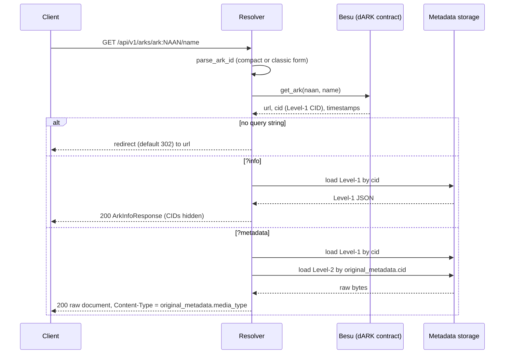

# Resolver architecture

`dark-core-resolver-api` is a stateless, read-only FastAPI service. It has no
database, no workers and no write endpoints. The blockchain is the only source of
truth for whether an ARK exists and where it points; shared storage supplies the
optional metadata views.

## Module map

| Path | Role |
|---|---|
| `app/main.py` | `create_app()`: FastAPI app (`/docs`, `/redoc`), permissive CORS, exception handlers, `/api/v1` router, health endpoints, lifespan hooks |
| `app/api/router.py`, `app/api/arks.py` | One catch-all route `GET\|HEAD /api/v1/arks/{ark:path}` |
| `app/services/resolver_service.py` | `ResolverService`: redirect, public info, raw metadata |
| `app/dependencies.py` | Process-wide read-only `DARKCoreClient` and `MetadataStorage` (initialized in the lifespan) |
| `app/config.py` | `Settings` (pydantic-settings), `.env.integration` preferred over `.env` when present |
| `app/models/public.py` | `ArkInfoResponse`, `AlternateIdentifierResponse` |
| `app/exceptions/handlers.py` | Maps `ValueError` to `400` |
| `tests/` | `test_resolver.py` with mocked chain client and storage (`conftest.py`) |

## Dependencies on `dark-core-lib`

The resolver reuses the SDK so that it stays aligned with the Minter:
`DARKCoreClient` (constructed with `read_only=True`, so no signer is configured),
`parse_ark_id`, `MetadataService` and `get_metadata_storage`. The `Level1Metadata`
schema and the Level-2 reference shape (`schema`, `media_type`, `cid`) therefore
come from one place.

## Resolution flow

- Every request starts with a blockchain read; there is no cache. On-chain data
  can change when an ARK is updated; subsequent requests read the chain again.
- Level 1 is always JSON. Level 2 is raw bytes: storage keeps no semantics, and the
  resolver rebuilds the content type from `L1.original_metadata.media_type`.
- The structured `?info` projection does not add the stored metadata CIDs. The
  raw `?metadata` response returns the original document unchanged.
- If storage is down, the default redirect still works as long as the chain is
  healthy; `?info` and `?metadata` need storage.

## ARK input forms

`parse_ark_id` accepts compact `ark:NAAN/name` and classic `ark:/NAAN/name` (at most
one slash after `ark:`), trims whitespace, and rejects empty parts, embedded
whitespace and anything not starting with `ark:`. Invalid input is `400`. The
response of `?info` uses the compact canonical form.

## Failure model

| Condition | Status |
|---|---|
| Malformed ARK; both `?info` and `?metadata` | `400` |
| ARK not on chain | `404` |
| Chain resolution error (`ARKError`) | `502` |
| Level-1 CID empty, not found in storage, backend error or invalid payload | `502` |
| `?metadata` without a Level-2 CID, or Level-2 not found | `404` |
| `?metadata` with storage backend error | `502` |

## Deployment topology

The deployer runs one or more Resolver instances, each bound to a Store reader
(`resolver.instances.<id>` with `group`, `reader`, `rpc` in the operator
inventory) and an RPC provider. The edge proxy publishes it, typically mapping the
public path `/` to `/api/v1/arks/`. Several instances may run in parallel because
the service is stateless.
